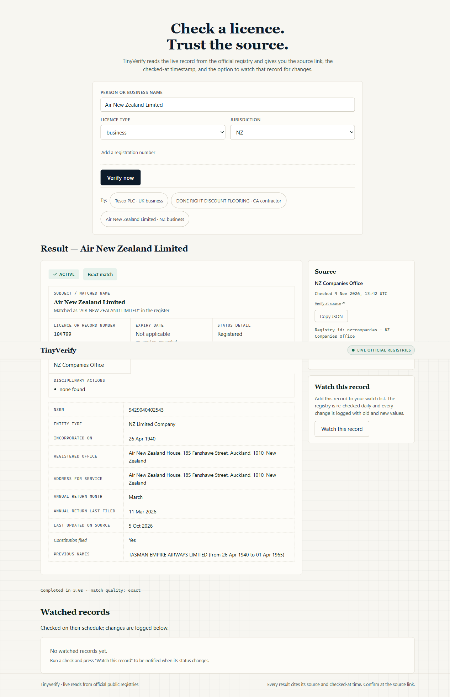
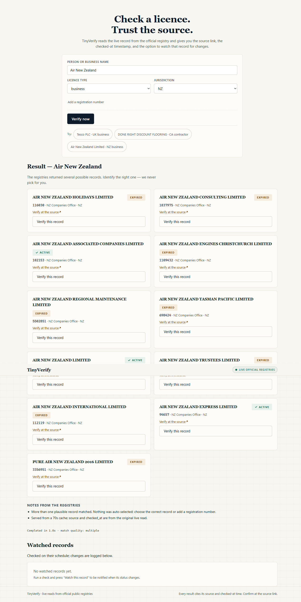

# TinyVerify

**Live demo:** https://tinyverify.vercel.app
**Repo:** https://github.com/Venkata-Manoj/tinyverify

TinyVerify answers a question a hiring manager or compliance team actually has to answer:

> Is this doctor licensed? Is this contractor in good standing? Is this company still registered?

You give a **name**, a **record type** and a **jurisdiction**. TinyVerify reads the **live official registry**, returns a structured record with the **source link** and a **`checked_at` timestamp**, and can **watch that record** so a status change is caught without re-checking by hand.

It never invents a record. If the official source cannot confirm one, the answer is `no_match`. If several records could be the same subject, every candidate is returned and none is auto-selected.



---

## Try it

Open https://tinyverify.vercel.app and press one of the sample chips:

| Sample | What it proves |
|---|---|
| **Tesco PLC** · business · UK | Exact match on the UK company register |
| **DONE RIGHT DISCOUNT FLOORING** · contractor · US-CA | Revoked California licence with expiry date and complaint disclosure |
| **Air New Zealand Limited** · business · NZ | New Zealand company with NZBN, registered office and annual-return data |

Or verify from the CLI:

```bash
node cli.js verify "Tesco PLC" --type business --jurisdiction UK
node cli.js verify "Air New Zealand Limited" --type business --jurisdiction NZ --json
node cli.js watch "Tesco PLC" --type business --jurisdiction UK
node cli.js check mon_xxxxxxxxxxxx
```

---

## Coverage

| Record type | Jurisdiction | Official source | What comes back |
|---|---|---|---|
| `business` | `UK` | [UK Companies House](https://find-and-update.company-information.service.gov.uk) | status, company number, incorporation date, registered office, SIC codes, filing dates, previous names |
| `business` | `NZ` | [NZ Companies Office](https://www.companiesoffice.govt.nz) | status, company number, NZBN, entity type, incorporation date, registered office, annual-return data, previous names |
| `contractor` | `US-CA` | [California CSLB](https://www.cslb.ca.gov) | licence status, licence number, issue/expiry dates, classifications, bond, workers' comp, public complaint disclosure |
| `health` | `US` | [US NPPES NPI Registry](https://npiregistry.cms.hhs.gov) | enrolment status, NPI, provider name, taxonomy, state licence number |

Every adapter returns the same record shape, so adding a registry does not change the API or the UI:

```json
{
  "subject": "Tesco PLC",
  "licence_type": "business",
  "jurisdiction": "UK",
  "status": "active",
  "licence_number": "00445790",
  "expiry_date": null,
  "disciplinary_actions": ["none found"],
  "source_name": "UK Companies House",
  "source_url": "https://find-and-update.company-information.service.gov.uk/company/00445790",
  "checked_at": "2026-11-04T12:55:10.106Z",
  "match_quality": "exact",
  "registry_id": "companies-house-uk",
  "status_detail": "Active",
  "matched_name": "TESCO PLC",
  "fields": {
    "company_type": "Public limited Company",
    "incorporated_on": "1947-11-27",
    "registered_office": "Tesco House, Shire Park, Kestrel Way, Welwyn Garden City, United Kingdom, AL7 1GA",
    "sic": ["47110 - Retail sale in non-specialised stores with food, beverages or tobacco predominating"]
  },
  "notes": []
}
```

Field meanings and the exact matching rules are in [docs/verification.md](docs/verification.md). Per-registry notes and rejected sources are in [docs/registries.md](docs/registries.md).

---

## How TinyFish is used

TinyFish does the web work that plain HTTP cannot. Four endpoints are used, each for a job the other cannot do:

### 1. TinyFish Search — resolve the official record page

Some registries have no usable public search API. TinyVerify asks TinyFish Search for the record on the official domain, then filters results so only official record URLs survive:

- **UK Companies House** — `include_domains=find-and-update.company-information.service.gov.uk`, keeps only `/company/<number>` links.
- **California CSLB** — `include_domains=cslb.ca.gov`, keeps only `cslb.ca.gov/<licence-number>` links.

A result from any other domain is discarded. Search never supplies a status; it only finds the URL of the page that does.

### 2. TinyFish Fetch — read the official page

`lib/tinyfish.js` batches up to 10 URLs per Fetch call (`format: markdown` or `html`, `ttl: 0` for a fresh read). Used by:

- **UK Companies House** — fetch the company overview page and the paginated search result list (HTML parsing for links).
- **US NPPES NPI Registry** — Node's `fetch` fails with `EAI_AGAIN` for `npiregistry.cms.hhs.gov`; TinyFish Fetch reads the JSON API reliably, returned as `html` and parsed as JSON.
- **California CSLB** — Search resolves the short record URL, then a direct fetch reads the detail page. (CSLB is not bot-protected for plain GETs.)

### 3. TinyFish Agent — drive CSLB's form when Search fails

CSLB's "Check A License" name search is a session-based ASP.NET form. TinyFish Search often resolves a known business, but not every contractor has an indexed record page.

When Search returns no CSLB record URL, TinyVerify starts a **TinyFish Agent** run on `CheckLicense.aspx`, tells it to choose *Check by Business Name*, enter the name, submit, and return up to 10 licence numbers using a JSON output schema. The Agent only supplies **licence numbers**; TinyVerify then fetches each official detail page and reads the status, dates and disclosures itself. That keeps the agent out of the trust path.

Live evidence from this build:

```text
node cli.js verify "HALA TREE SERVICE" --type contractor --jurisdiction US-CA
Match quality: multiple (78.8 s)
  HALA TREE SERVICES   | 574648  | expired | https://www.cslb.ca.gov/574648
  HALA TREE SERVICE INC| 1000000 | expired | https://www.cslb.ca.gov/1000000
```

Both records were confirmed against CSLB directly (`1000000`: expired 2019-01-31; `574648`: cancelled 1993-05-24). The agent result is cached for 10 minutes so a retry does not start another browser run.

### 4. TinyFish Monitor — watch the record for changes

Creating a watch does two things:

1. Verifies the record live and stores a **baseline snapshot** (`status`, `licence_number`, `expiry_date`, `disciplinary_actions`, `status_detail`).
2. Creates a **TinyFish Monitor** of type `fetch` on the official record URL, scheduled daily (`0 8 * * *` by default), with a webhook back to TinyVerify when the page changes.

A monitor check re-reads the source and diffs the new snapshot against the stored one. Only real changes produce events:

```json
{
  "id": "evt_...",
  "changed_fields": ["status", "status_detail"],
  "old": { "status": "active", "status_detail": "Active" },
  "new": { "status": "suspended", "status_detail": "Proposal to strike off" },
  "summary": "Status changed from active to suspended. Status detail changed from Active to Proposal to strike off",
  "checked_at": "2026-11-05T08:00:00.000Z",
  "source_url": "https://find-and-update.company-information.service.gov.uk/company/00445790"
}
```

A transient registry miss — a timeout, a bot challenge, a page that no longer parses — is **not** a change. The previous snapshot is kept and the check is marked failed, because "the site was down" is not "the licence was revoked".

---

## Ambiguity handling

`match_quality` is always one of `exact`, `close`, `multiple`, `no_match`, `unsupported`.

| Situation | Behaviour |
|---|---|
| One record, name identical after normalisation | `exact` |
| One record, name a plausible variant (e.g. missing legal suffix) | `close`, with `matched_name` and confidence |
| Several records above the match threshold | `multiple` — every candidate returned, **nothing auto-selected** |
| Records below the threshold | `near_misses` — shown separately, never counted as matches |
| No record at all | `no_match`, plus the exact searches performed |
| Type/jurisdiction we do not cover | `unsupported`, with the supported combinations |

Name variants (comma order, missing legal suffix, middle initials) are tried at most twice. Two registries answering for the same subject are returned as separate records; if their statuses disagree the response is `status: "unknown"` with both records and an explicit conflict note, never a merge.



---

## HTTP API

All responses are JSON. `POST /api/verify` is the main entry point; no API key is needed by callers.

| Method | Path | Purpose |
|---|---|---|
| `GET` | `/api/health` | Version, configured registries, storage backend |
| `GET` | `/api/registries` | Registry metadata + supported combinations |
| `GET` | `/api/coverage` | Coverage matrix only |
| `POST` | `/api/verify` | Verify a record |
| `GET` | `/api/monitors` | List watches |
| `POST` | `/api/monitors` | Create a watch from a confirmed record |
| `GET` | `/api/monitors/:id` | Watch + change events |
| `POST` | `/api/monitors/:id/check` | Re-read the source now, diff, return any event |
| `DELETE` | `/api/monitors/:id` | Delete the watch and its TinyFish Monitor |
| `POST` | `/api/webhooks/tinyfish` | TinyFish Monitor callback (optional shared secret) |

```bash
curl -s https://tinyverify.vercel.app/api/verify \
  -H 'content-type: application/json' \
  -d '{"subject":"Air New Zealand Limited","licence_type":"business","jurisdiction":"NZ"}'
```

```bash
curl -s https://tinyverify.vercel.app/api/verify \
  -H 'content-type: application/json' \
  -d '{"subject":"DONE RIGHT DISCOUNT FLOORING","licence_type":"contractor","jurisdiction":"US-CA"}'
```

Every successful response includes `checked_at` and, per record, `source_url`. Results are cached for 10 minutes; a cached response keeps the original `source_url` and `checked_at` and says so in `notes`, with `cached: true`.

---

## Run it locally

Requires Node 22+. Zero runtime dependencies.

```bash
cp .env.example .env          # add TINYFISH_API_KEY
npm run dev                   # http://localhost:3000
npm test                      # 33 unit tests, no network
npm run check                 # syntax check of entry points
```

`.env`:

```ini
TINYFISH_API_KEY=...
# optional
TINYVERIFY_WEBHOOK_SECRET=...
TINYVERIFY_MONITOR_CRON=0 8 * * *
TINYVERIFY_PUBLIC_URL=https://your-deployment
KV_REST_API_URL=...
KV_REST_API_TOKEN=...
```

Monitors persist in Upstash Redis (`KV_REST_API_URL` + `KV_REST_API_TOKEN`) in production, or an atomic JSON file under `data/` locally. The TinyFish API key is only read server-side and is never returned by any endpoint.

---

## Tests and evidence

```text
npm test  →  33 tests, 33 pass
```

Covered without network access: name normalisation and variants, status vocabulary, date parsing (day-first and month-first), all four registry parsers against captured live pages, match classification, registry resolution, snapshot diffing, monitor lifecycle, transient-miss handling, HTTP routing and error shapes.

Live evidence captured during the build is in `spikes/` (`api-proof.json` for Search/Fetch/Agent/Monitor responses, `cslb-agent.mjs` for the Agent run).

---

## Known limits

- **Not covered yet:** Australia (AHPRA) and UK health regulators (HCPC, GMC). AHPRA works only through a metered stealth Agent run and needs a disambiguation rule; HCPC sits behind a Cloudflare interstitial; GMC renders its register client-side. They are documented as rejected sources rather than shipped as broken checks.
- **CSLB name search** depends on either TinyFish Search finding a record URL or the Agent fallback running; a name-only lookup can take up to ~2.5 minutes. Supplying a licence number is always faster and exact.
- **NPI is an enrolment registry**, not a state licence board. It shows the state licence number a provider declared but does not publish that licence's status; the record says so.
- **UK Companies House / NZ** company records have no expiry date. `expiry_date` is `null` and the UI says "Not applicable" instead of inventing one.
- **Monitors** re-verify through TinyVerify's own pipeline on every check, so a change event always carries a fresh `source_url` and `checked_at`, even if the TinyFish webhook payload is incomplete.

## Licence and data

Application code: MIT. Registry data remains subject to each registry's terms. Companies House data is Crown copyright; CSLB and NPPES are US public records; NZ Companies Office data is published by the New Zealand Companies Office. TinyVerify reports records; it does not give legal or hiring advice.
